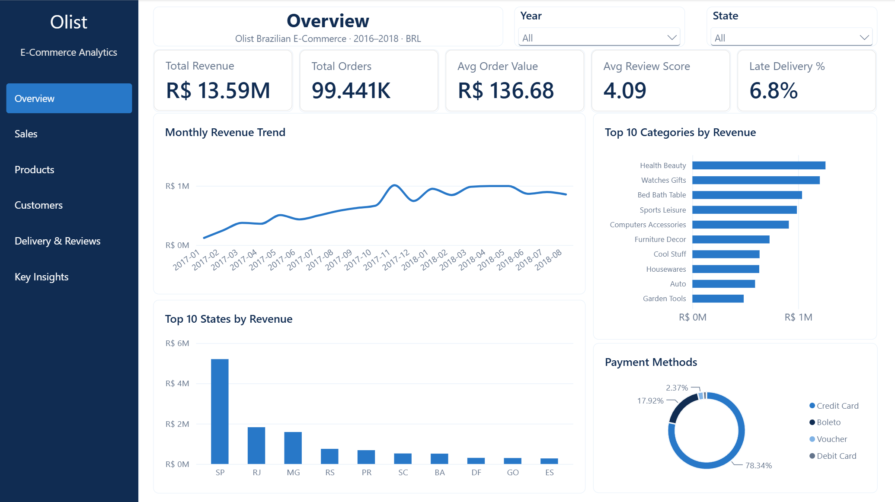
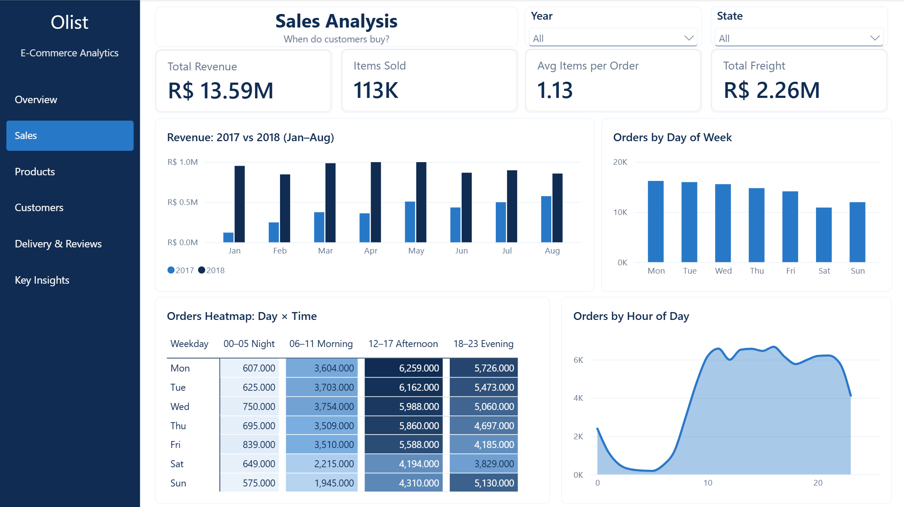
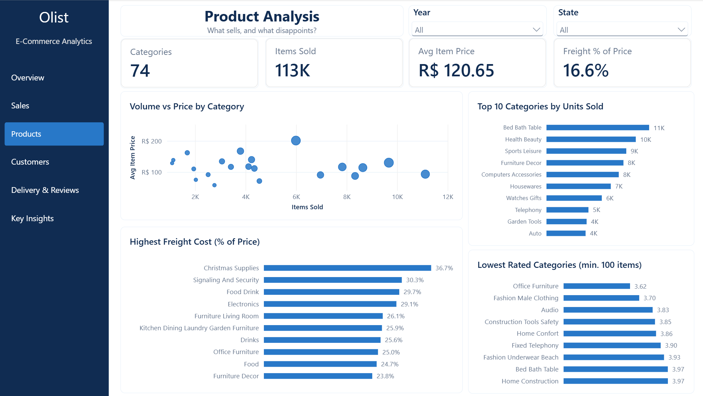
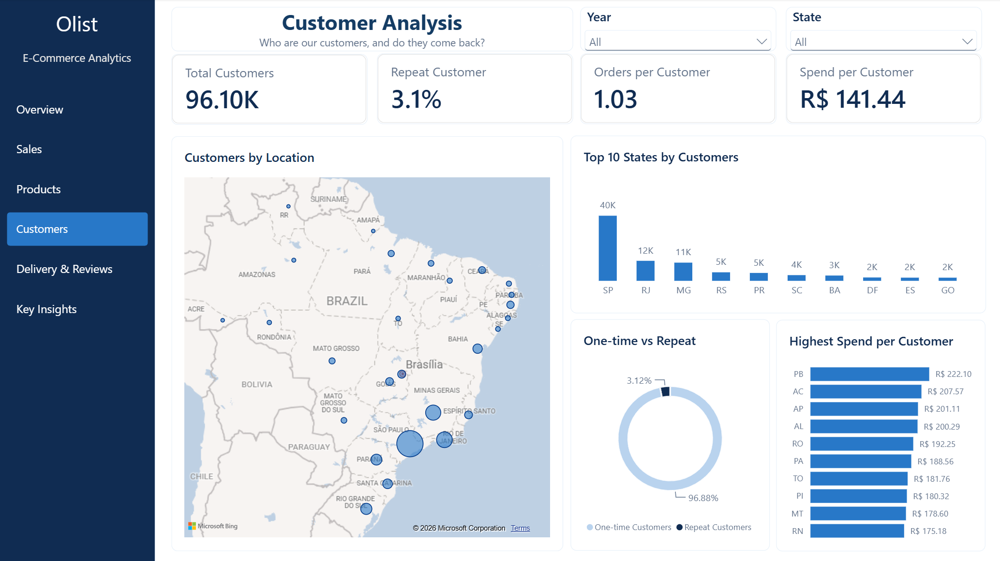
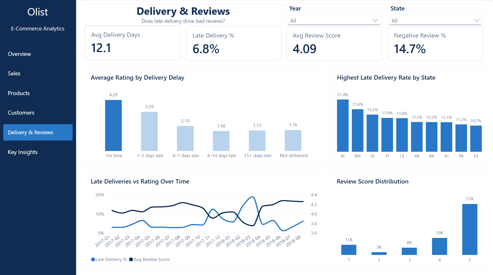

# Olist E-Commerce Analytics Dashboard (Power BI)

An end-to-end data analysis project on **~100K real orders** from Olist, a Brazilian e-commerce marketplace (2016–2018).
The project covers data import, cleaning in Power Query, data modeling, DAX measures, and a 6-page interactive dashboard.

**Main question:** What drives sales and customer satisfaction, and where are the biggest opportunities to improve?

**📥 Download:** [Power BI file (.pbix)](https://drive.google.com/file/d/11V8gL0yU7B2TIoIaTqZdcu4VXK1FHDk8/view?usp=sharing) · [PDF version](Olist_Ecommerce_Dashboard.pdf)



---

## Tools

| Tool | Used for |
|---|---|
| Power BI Desktop | Dashboard, data model, report design |
| Power Query (M) | Data import and cleaning |
| DAX | Measures and calculated columns |

---

## Dataset

- **Source:** Olist Brazilian E-Commerce Public Dataset (MIT license), available on Kaggle and Olist's official GitHub.
- **Size:** 9 related CSV tables, ~100K orders, and over 1 million rows in the geolocation table.
- **Period:** September 2016 – October 2018. Monthly charts use **Jan 2017 – Aug 2018**, because the months outside this range are incomplete.

| Table | Rows | Description |
|---|---|---|
| orders | 99,441 | Order status and timestamps |
| order_items | 112,650 | Products in each order, price and freight |
| order_payments | 103,886 | Payment type, installments and value |
| order_reviews | ~99K | Review score (1–5) |
| customers | 99,441 | Customer location |
| products | 32,951 | Product category and dimensions |
| sellers | 3,095 | Seller location |
| geolocation | 1,000,163 | Coordinates for each zip code prefix |
| category_translation | 71 | Portuguese → English category names |

---

## Data Cleaning (Power Query)

Every step is recorded in Power Query's *Applied Steps*, so the full process is reproducible with one click on **Refresh**.

| Problem found | How it was discovered | Fix |
|---|---|---|
| **Zip codes lost their leading zero** (e.g. `1151` instead of `01151`) in 24K customers and 1K sellers | Compared zip code lengths across tables: geolocation always had 5 digits | `Text.PadStart(..., 5, "0")` and kept zip codes as **Text** |
| **Empty review comments were empty strings, not null**, so a "has comment" flag returned "Yes" for every row | The new column showed only 1 distinct value | Checked for both `null` and `""` with `Text.Trim` |
| **Dirty seller city names**: `sao paulo - sp`, `auriflama/sp`, `rio de janeiro \rio de janeiro`, accents, and even an email and a phone number | Inspected distinct values for symbols like `/`, `-`, `\`, `,` | `Text.SplitAny` to keep the city part, then fixed special cases with exact-match replacements |
| **Geolocation: 261K duplicate rows and 42 coordinates outside Brazil** | Column profiling on the full dataset, and checking lat/lng ranges | Filtered to Brazil's geographic bounds, then grouped to **one row per zip code** (average lat/lng): 1M → ~19K rows |
| **Category names in Portuguese**; 2 categories missing from the translation table; 610 products with no category | Left-join match count was lower than the row count | Merged with the translation table and kept the original name or `Unknown` as a fallback |
| **Payments with type `not_defined` and value 0** (3 rows) | Distinct values in `payment_type` | Removed |
| Column name typos (`product_name_lenght`) and unused columns | Reviewed the schema | Removed the unused columns |

**Columns added:** `Delivery_days`, `Delay_days`, `Item_total`, `Purchase Hour`, `Time of Day`, `Delay Group`.

> **Note:** ~550 orders have more than one review (~0.5% of the data). They were kept, since their effect on the average rating is negligible.

---

## Data Model

A star-schema style model with a dedicated **Date** table and single-direction relationships.

- **Fact tables:** `Orders` (order header) and `Order_Items` (order lines)
- **Dimension tables:** `Customers`, `Products`, `Sellers`, `Date`
- **Related detail tables:** `Payments`, `Reviews`
- The geolocation and translation tables are used only during cleaning and are **not loaded** into the model.

---

## DAX Highlights

**Ratings by product category.** Reviews are linked to *orders*, not products, so a product filter can't reach the reviews table through single-direction relationships. Instead of making the relationship bidirectional for the whole model, `CROSSFILTER` enables both directions **only inside this measure**:

```DAX
Avg Rating (Product) =
CALCULATE(
    [Avg Review Score],
    CROSSFILTER(Order_items[order_id], Orders[order_id], Both)
)
```

**Repeat customers** are counted with the real person ID (`customer_unique_id`), because `customer_id` changes with every order:

```DAX
Repeat Customers =
COUNTROWS(
    FILTER(
        VALUES(Customers[customer_unique_id]),
        CALCULATE([Total Orders]) > 1
    )
)
```

**A fair Top 10 ranking** that only includes categories with at least 100 items sold:

```DAX
Rating Rank =
RANKX(
    FILTER(
        ALL(Products[Category]),
        [Items Sold] >= 100 && Products[Category] <> "Unknown"
    ),
    [Avg Rating (Product)], , ASC
)
```

---

## Dashboard Pages

| Page | Question it answers |
|---|---|
| **Overview** | How is the business doing overall? |
| **Sales** | When do customers buy? How did 2018 compare with 2017? |
| **Products** | What sells, and what disappoints? |
| **Customers** | Who are our customers, and do they come back? |
| **Delivery & Reviews** | Does late delivery drive bad reviews? |
| **Key Insights** | Main findings and recommendations |

The pages are connected by a custom navigation bar, and the Year and State filters are synced across all pages.

| | |
|---|---|
|  |  |
|  |  |

---

## Key Findings

1. **Delivery is strongly associated with satisfaction.** On-time orders average **4.29★**. A delay of just 1–3 days drops the rating to **3.29★**, and delays over a week bring it down to about **1.7★**.
2. **Customers rarely return.** Only **3.1%** of 96K customers placed a second order, so growth depends almost entirely on new customers.
3. **Sales are geographically concentrated.** São Paulo alone generates **38%** of revenue, while remote states face longer deliveries and higher delay rates (AL: **21%** late).
4. **Strong growth.** Revenue for Jan–Aug 2018 was **more than double** the same period of 2017 (+137%), with a peak around Black Friday (Nov 2017).
5. **Buying peaks on weekday afternoons.** Monday has the most orders, and activity almost stops between 2 and 6 AM.
6. **Bulky products are a pain point.** Office furniture has the lowest rating (**3.62★**), and its freight costs **25%** of the product price.

## Recommendations

1. Improve logistics in high-delay states (AL, MA, RJ), or set more realistic delivery estimates there.
2. Launch a loyalty program (e.g., a coupon after the first order) to turn one-time buyers into repeat customers.
3. Review shipping for furniture and bulky items, which combine high freight cost with the lowest ratings.
4. Schedule marketing campaigns for weekday afternoons, when order volume peaks.

## Limitations

- The link between delays and ratings is a strong **association**, not proof of causation.
- Reviews are given per **order**, not per product. When an order has items from several categories, its review counts for each of them. Since the average order has only 1.13 items, the effect is small.
- The data ends in 2018, so the patterns may have changed since then.

---

## Repository Structure

```
├── Olist_Ecommerce_Dashboard.pdf    # Static PDF export
├── Olist_Theme.json                 # Custom color theme
├── Screenshots/                     # Dashboard page images
└── README.md
```

The Power BI file is larger than GitHub's upload limit, so it is hosted on Google Drive (see the download link at the top). The raw data is not included. Download it from Kaggle: *Brazilian E-Commerce Public Dataset by Olist*.

---

**Author:** Abdullah Aldakhil · [LinkedIn](https://www.linkedin.com/in/abdullah-aldakhil-3866a436a/)
